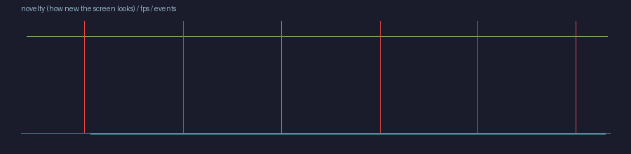
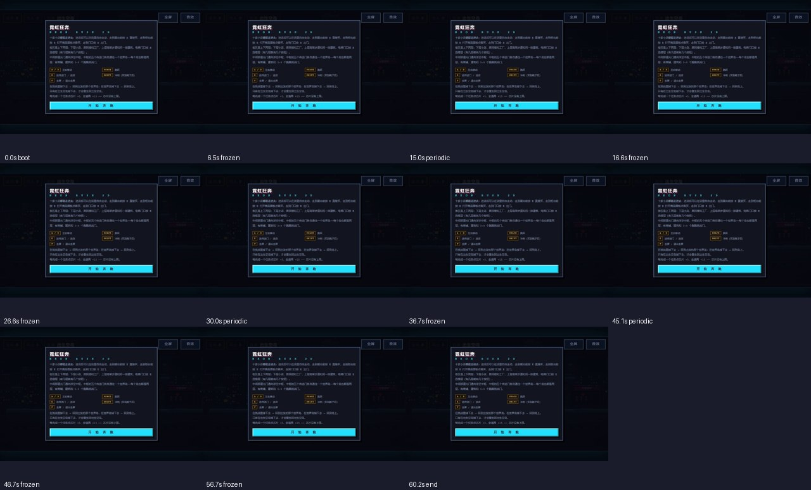

# Playtest report — ROUGH

- policy **explorer**, 60.2s, telemetry: False
- FPS avg 60.0 / p5 60 / min 60
- events: {} · deaths 0 · wins 0 · first event at Nones
- explored 0 map cells · mean novelty 0.0

## Issues

- **[major]** Input had no visible effect — screen unchanged for 6s while input was held (t=6.5s) 
- **[major]** Input had no visible effect — screen unchanged for 6s while input was held (t=16.6s) 
- **[major]** Input had no visible effect — screen unchanged for 6s while input was held (t=26.6s) 
- **[major]** Input had no visible effect — screen unchanged for 6s while input was held (t=36.7s) 
- **[major]** Input had no visible effect — screen unchanged for 6s while input was held (t=46.7s) 
- **[major]** Input had no visible effect — screen unchanged for 6s while input was held (t=56.7s) 
- **[design]** Low-novelty stretch (likely boring) — 7s–60s: the screen barely changed and nothing happened (t=7.14s)

