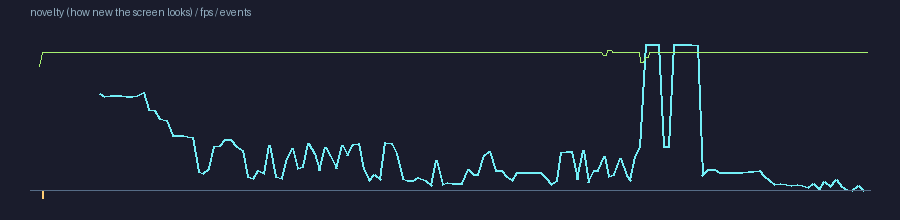
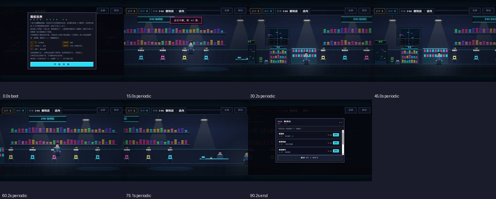

# Playtest report — PLAYABLE

- policy **explorer**, 90.2s, telemetry: True
- FPS avg 60.0 / p5 60 / min 54
- events: {'coin': 1, 'enter': 1, 'scene': 1} · deaths 0 · wins 0 · first event at 1.3s
- explored 48 map cells · mean novelty 0.0159

## Issues

- **[design]** Nothing happens — 6s–90s: 84s of play with no game event (no pickup, fight, damage or progress) (t=6.0s)

