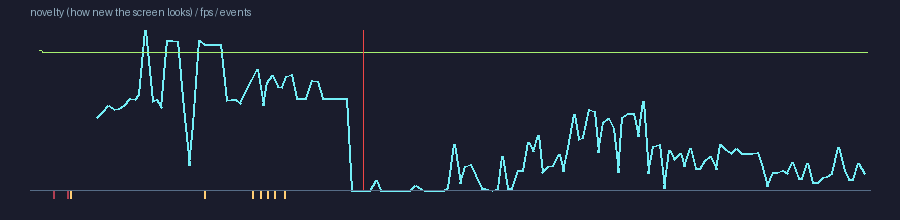
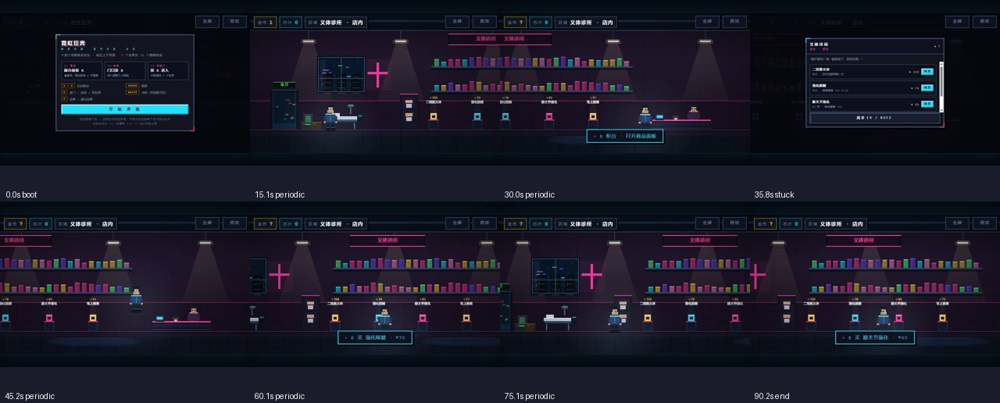

# Playtest report — ROUGH

- policy **explorer**, 90.2s, telemetry: True
- FPS avg 60.0 / p5 60 / min 60
- events: {'death': 2, 'coin': 7, 'enter': 2, 'scene': 2} · deaths 2 · wins 0 · first event at 2.5s
- explored 43 map cells · mean novelty 0.0153

## Issues

- **[major]** Player got stuck — no movement for 4.1s while holding ['ArrowUp'] at (955, 280) (t=35.8s) 
- **[design]** Nothing happens — 27s–90s: 63s of play with no game event (no pickup, fight, damage or progress) (t=27.3s)
- **[design]** Low-novelty stretch (likely boring) — 34s–46s: the screen barely changed and nothing happened (t=34.47s)

